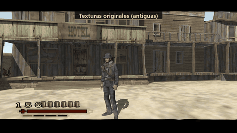
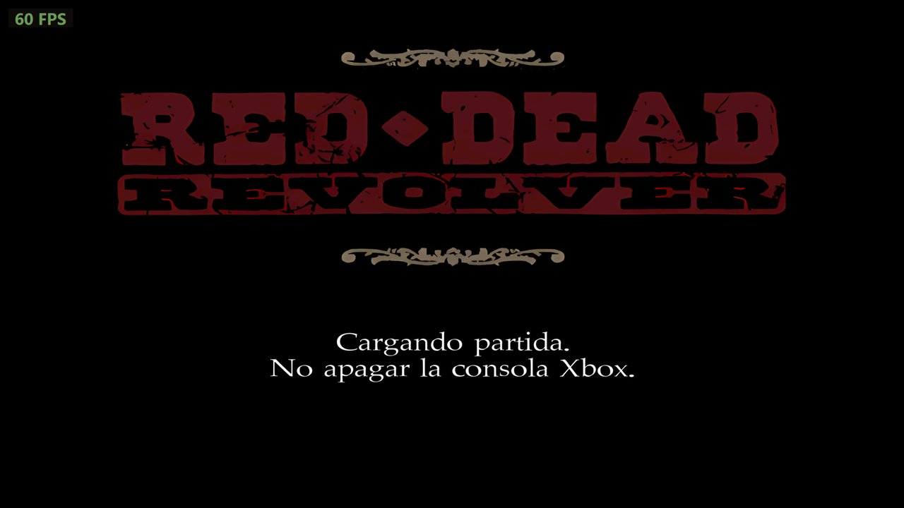
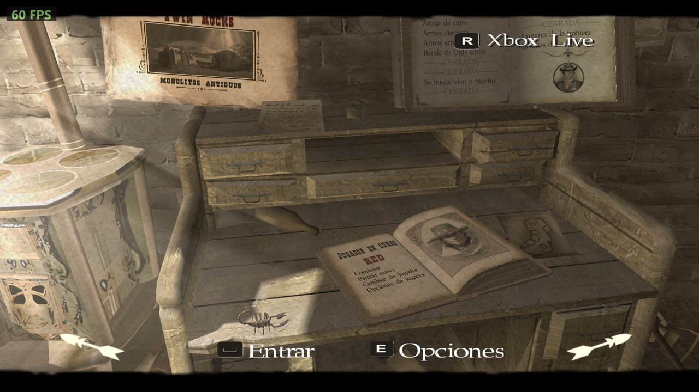
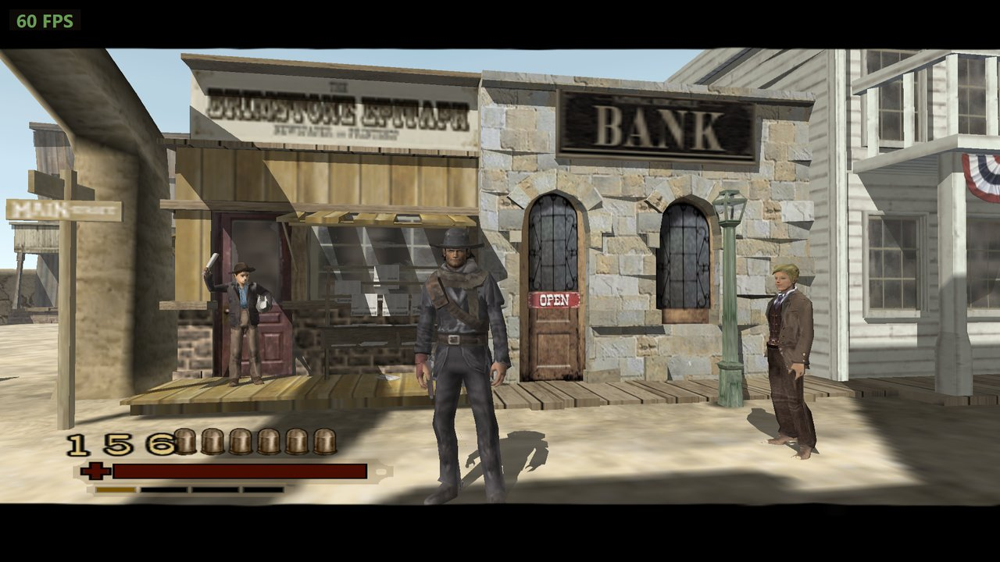
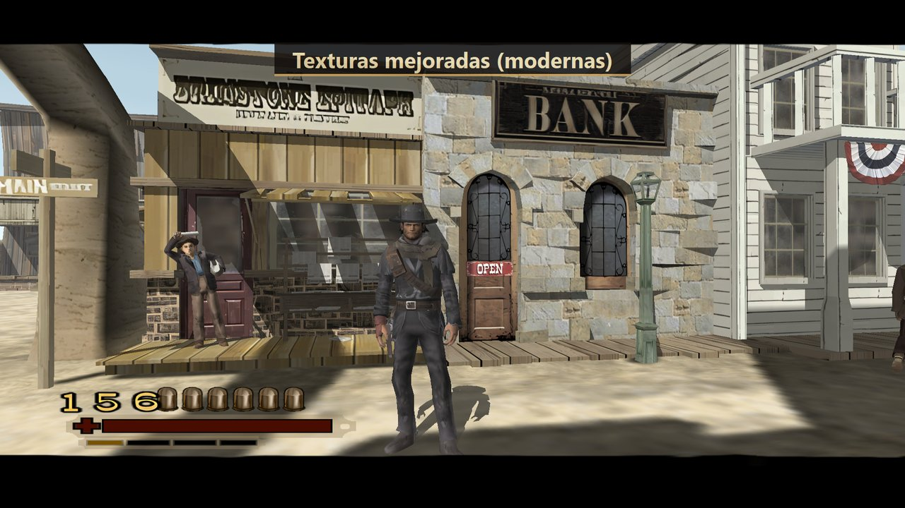
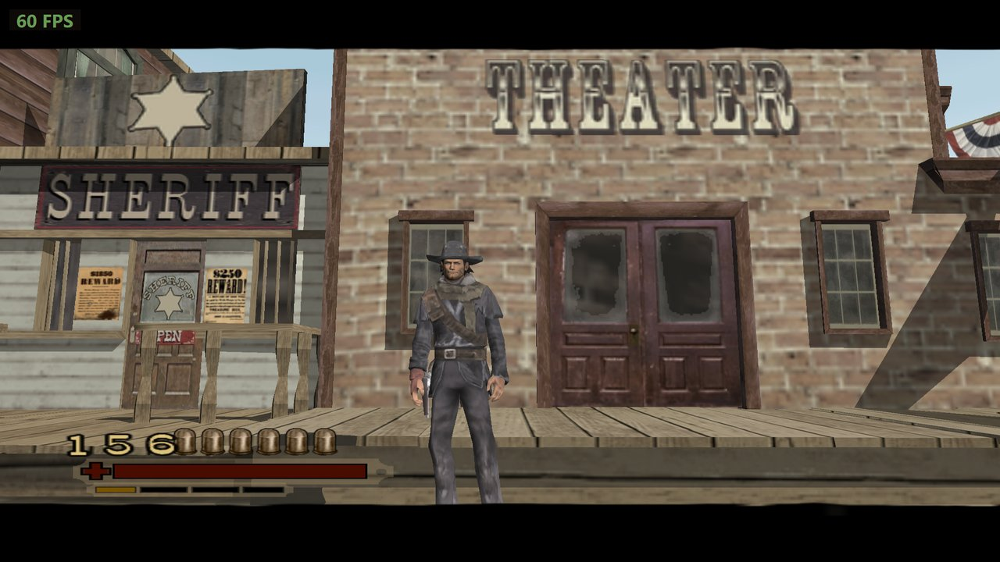
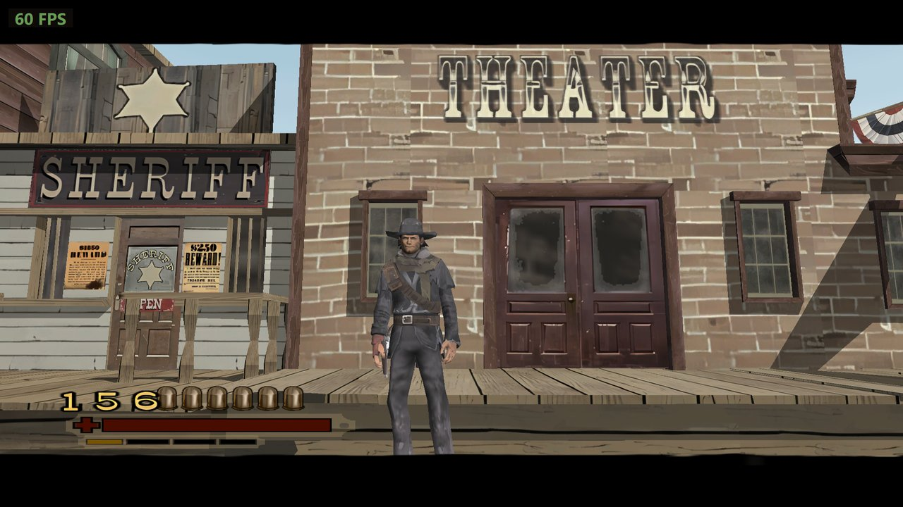

# Red Dead Revolver — PC port (Xbox static recompilation)

**[English](#english) · [Español](#español)**

<p align="center"></p>

| | |
|:---:|:---:|
|  |  |

**Original textures → improved textures (F6)**

| Original | Improved / Mejoradas |
|:---:|:---:|
|  |  |
|  |  |

### Downloads / Descargas

| | |
|---|---|
| **Game port / Port del juego** (required / obligatorio) | [RedDeadRevolverPC.zip — Releases](https://github.com/dennisabalo18-bot/red-dead-revolver-pc/releases/latest) |
| **Improved textures / Texturas mejoradas** (optional, 2.7 GB) | [RDR-PC-Texturas.zip — Google Drive](https://drive.google.com/file/d/1eiFxd7sHNGc7IdHdqkKh95KRyHEnVx5A/view?usp=sharing) |
| **Remastered videos / Videos mejorados** (optional, 1 GB) | [RDR-PC-Videos.zip — Google Drive](https://drive.google.com/file/d/1bS0AZgfILsd5EulgOEys5Ll3LKs9uKai/view?usp=sharing) |

---

## English

A native Windows port of the original Xbox release of *Red Dead Revolver*
(Rockstar San Diego, 2004), made by **static recompilation**: the game's x86
code is translated to C and compiled for PC, and an Xbox runtime
([xboxrecomp](https://github.com/sp00nznet/xboxrecomp), fork by
[apexJCL](https://github.com/apexJCL/xboxrecomp)) stands in for the console's
kernel, GPU (drawn with Direct3D 11), audio and controllers. It is not an
emulator.

> **No game files are included.** You need your own legitimate copy of the Xbox
> game. Rockstar Games and Take-Two own *Red Dead Revolver*; this project is not
> affiliated with or endorsed by them.

### Features

- Runs at the game's 60 Hz with GPU rendering, internal resolution up to 4x
  (2560x1920), anisotropic filtering, widescreen 16:9 (the game's own mode),
  borderless fullscreen (F11).
- Keyboard and mouse: direct mouse camera, free aiming, all keys mapped.
- Controllers: Xbox (XInput) and PlayStation / generic pads (SDL3). On-screen
  buttons follow the device you use (keyboard, Xbox or PlayStation icons), or a
  style you pick.
- In-game settings menu (**F2**) and an external **Configuración.exe**
  launcher.
- Optional mods, loaded from `Mods-Extras\` when present:
  improved textures (AI-upscaled, BC3-compressed pack, **F6** toggles them),
  sharp redrawn menu fonts, and remastered 60 fps cutscenes (MP4).

### Playing

```
Red Dead Revolver PC\
  RedDeadRevolver.exe     the game
  Configuración.exe       settings launcher
  Instalar juego desde ISO.bat   extracts your game ISO into Game\
  Game\                   ← your Xbox game goes here (default.xbe, *.dat, bik\ ...)
  Mods-Extras\            ← optional: textures.pack and videos\*.mp4 (any subfolder works)
  Herramientas\           extract-xiso
```

1. Download `RedDeadRevolverPC.zip` from **Releases** and unzip it.
2. Put your game in `Game\`: drag your Xbox ISO onto `Instalar juego desde ISO.bat`,
   or copy the already extracted files there (a folder inside it is fine).
3. Optional: download the improved textures and videos (see **Downloads**
   above) and unzip both inside `Mods-Extras\`: they already bring their
   `texturas\` and `videos\` folders.
4. Open `Configuración.exe`, choose your settings and press **JUGAR**.

In game: **F2** settings · **F6** improved textures on/off · **F11** fullscreen ·
**F9** free the mouse. A log is written to
`registro.txt` next to the exe.

### Building from source

Requirements: Windows 10/11 x64, Visual Studio 2022/2026 with clang-cl, CMake,
Python 3 (Pillow, NumPy), your own copy of the game.

1. Put your extracted game in `juego\` at the project root (or set the
   `RDR_JUEGO` environment variable to its folder), and copy its `default.xbe`
   to `game_files\`.
2. Generate the C code from the XBE with the xboxrecomp tools into
   `rdr-apex\src\recomp\gen\` (not in the repository: it is derived from the
   game), then run `python tools\rename_pads.py`.
3. Build: `cmake -S rdr-apex -B rdr-apex\build -A x64 -T ClangCL
   -DXBOXRECOMP_SDL3_DIR=<SDL3 folder>` and
   `cmake --build rdr-apex\build --config Release`.
4. `rdr-apex\run.bat` runs it from the build; `tools\armar_paquete.ps1` lays
   out the player's folder in `dist\` (`-Release` also makes
   `dist\RedDeadRevolverPC.zip`, without game, textures or videos).

Mod tools live in `tools\` (texture dump/upscale/pack, BC3 encoder, font
redraw, button styles, video upscale and 60 fps). `ESTADO.md` is the working
log (in Spanish).

### Credits and licenses

- xboxrecomp — MIT, © sp00nz; fork by apexJCL.
- SDL3 — zlib license.
- extract-xiso — BSD-style license, © in@fishtank.com (`tools\extract-xiso\LICENSE.TXT`).
- Icons: made locally from the game's cover by `tools\iconos.py`; not
  distributed.

---

## Español

Un port nativo para Windows de la versión original de Xbox de *Red Dead
Revolver* (Rockstar San Diego, 2004), hecho por **recompilación estática**: el
código x86 del juego se traduce a C y se compila para PC, y un runtime de Xbox
([xboxrecomp](https://github.com/sp00nznet/xboxrecomp), fork de
[apexJCL](https://github.com/apexJCL/xboxrecomp)) reemplaza el kernel, la GPU
(dibujada con Direct3D 11), el audio y los mandos de la consola. No es un
emulador.

> **No incluye archivos del juego.** Necesitás tu propia copia legítima del
> juego de Xbox. *Red Dead Revolver* es de Rockstar Games y Take-Two; este
> proyecto no está afiliado ni avalado por ellos.

### Qué tiene

- Corre a los 60 Hz del juego con dibujo por GPU, resolución interna hasta 4x
  (2560x1920), filtrado anisotrópico, panorámico 16:9 (el modo propio del
  juego) y pantalla completa sin bordes (F11).
- Teclado y ratón: cámara directa con el ratón, mira libre, todas las teclas.
- Mandos: Xbox (XInput) y PlayStation / genéricos (SDL3). Los botones en
  pantalla siguen al dispositivo que usás (teclado, Xbox o PlayStation), o el
  estilo que elijas.
- Menú de ajustes en el juego (**F2**) y un lanzador aparte,
  **Configuración.exe**.
- Mods opcionales, desde `Mods-Extras\` si están: texturas mejoradas (escaladas
  con IA, paquete comprimido en BC3, **F6** las prende y apaga), letras de los
  menús redibujadas nítidas y videos remasterizados a 60 fps (MP4).

### Cómo jugar

```
Red Dead Revolver PC\
  RedDeadRevolver.exe     el juego
  Configuración.exe       los ajustes
  Instalar juego desde ISO.bat   saca el juego de tu ISO a Game\
  Game\                   ← acá va tu juego de Xbox (default.xbe, *.dat, bik\ ...)
  Mods-Extras\            ← opcional: textures.pack y videos\*.mp4 (sirve cualquier subcarpeta)
  Herramientas\           extract-xiso
```

1. Bajá `RedDeadRevolverPC.zip` de **Releases** y descomprimilo.
2. Poné tu juego en `Game\`: arrastrá tu ISO de Xbox sobre
   `Instalar juego desde ISO.bat`, o copiá ahí los archivos ya descomprimidos
   (puede ir dentro de otra carpeta).
3. Opcional: bajá las texturas y los videos mejorados (ver **Descargas**, arriba)
   y descomprimí los dos dentro de `Mods-Extras\`: ya traen sus carpetas
   `texturas\` y `videos\`.
4. Abrí `Configuración.exe`, elegí los ajustes y tocá **JUGAR**.

En el juego: **F2** ajustes · **F6** texturas mejoradas sí/no · **F11**
pantalla completa · **F9** libera el ratón. El
registro queda en `registro.txt`, junto al exe.

### Compilar desde el código

Requisitos: Windows 10/11 x64, Visual Studio 2022/2026 con clang-cl, CMake,
Python 3 (Pillow, NumPy) y tu copia del juego.

1. Poné el juego descomprimido en `juego\`, en la raíz del proyecto (o definí
   la variable de entorno `RDR_JUEGO` con su carpeta), y copiá su `default.xbe`
   a `game_files\`.
2. Generá el código C desde el XBE con las herramientas de xboxrecomp en
   `rdr-apex\src\recomp\gen\` (no está en el repositorio: sale del juego) y
   corré `python tools\rename_pads.py`.
3. Compilá: `cmake -S rdr-apex -B rdr-apex\build -A x64 -T ClangCL
   -DXBOXRECOMP_SDL3_DIR=<carpeta de SDL3>` y
   `cmake --build rdr-apex\build --config Release`.
4. `rdr-apex\run.bat` lo abre desde la compilación; `tools\armar_paquete.ps1`
   arma la carpeta del jugador en `dist\` (`-Release` además arma
   `dist\RedDeadRevolverPC.zip`, sin juego, texturas ni videos).

Las herramientas de mods están en `tools\` (volcado, escalado y paquete de
texturas, compresor BC3, redibujo de letras, estilos de botones, escalado de
videos y 60 fps). `ESTADO.md` es la bitácora del trabajo.

### Créditos y licencias

- xboxrecomp — MIT, © sp00nz; fork de apexJCL.
- SDL3 — licencia zlib.
- extract-xiso — licencia tipo BSD, © in@fishtank.com (`tools\extract-xiso\LICENSE.TXT`).
- Íconos: se generan localmente desde la portada del juego con
  `tools\iconos.py`; no se distribuyen.
